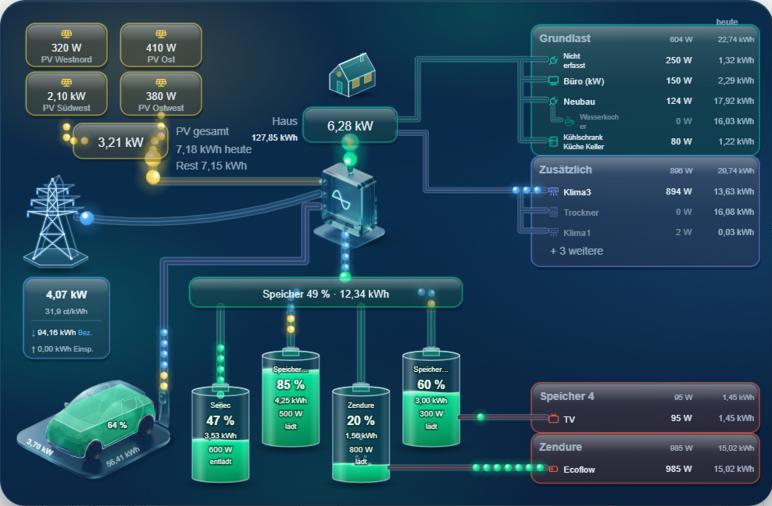

<p align="center">
  
</p>

<h1 align="center">Energiefluss</h1>

<p align="center"><b>Animated energy flow for Home Assistant — PV, batteries, grid, house and every load, in one card.</b></p>

Energiefluss is a Home Assistant custom integration with two Lovelace cards:

- **Energiefluss Glas** – a 2.5D glass look: glass tubes, trains of glowing balls whose number shows the power, batteries filled with sloshing liquid, a glass car at the wallbox.
- **Energiefluss** – the classic, flat look with the same data.

The integration does the bookkeeping (energy balance, missing values, daily energy counters); the cards only draw. Everything is set up in a visual editor – no YAML needed.



<details>
<summary>Classic look</summary>


</details>

*Screenshots with simulated values.*

> **Status:** early version (0.x). The user interface of the cards and the editor is in **German**; the integration's entities have German and English names.

---

## Features

**Integration**

- Visual setup in its own sidebar page *Energiefluss* and in the card's "edit card" dialog.
- *Detect sensors*: suggests PV strings, batteries, grid, prices, wallbox and loads from your existing entities.
- PV: up to 4 strings, total, today's yield, forecast rest.
- Batteries: up to 5, each with power, state of charge and capacity; power as one signed sensor or as separate charge / discharge sensors.
- Grid: one signed sensor or separate import / export sensors; current price (e.g. Tibber) and feed-in tariff.
- Loads in two groups: **Grundlast** (base load) and **Zusatzverbraucher** (additional / controllable loads); loads contained in other loads (e.g. a kettle measured inside a sub-distribution) are counted only once.
- Backup outputs: up to 2 batteries can feed their own backup loads. Batteries that cannot feed the house at all (e.g. EcoFlow on its own sockets) can be marked *only via backup*: their input (incl. pass-through) counts on the house side, their output only goes to their backup loads.
- Wallbox / EV with the car's state of charge.
- Fills gaps: if one of house, grid, PV or a single battery is not measured, it is calculated from the others.
- Own sensors: totals per group, *not measured* (house minus all measured loads), surplus, battery totals, and daily energy (since midnight or rolling 24 h) for every load and for house, PV, grid and batteries – kept across restarts.

**Glass card**

- Trains of balls instead of single dots: one **big ball per full 1000 W**, one **medium ball per full 100 W** and one **small ball per full 10 W** of the rest (below 10 W no ball) – bigger ones always lead, so you can read the power off the train.
- Ball colours show where the power comes from: **yellow** PV, **green** battery, **blue** grid – for the house, every load, the wallbox and charging batteries.
- Where lines meet (PV total, house, storage) the trains run into a wobbling mercury drop and leave it counted anew.
- Batteries and the car fill with sloshing liquid up to their state of charge; drops fall in while charging, bubbles rise into the line while discharging.
- Long load lists show the biggest daily consumers first (8 base loads, 3 additional loads) and fold the rest behind "+ N weitere".
- Lines route around batteries automatically.
- The PV strings sit on a glass solar panel.
- Click any value to open its sensor.

---

## Installation

### HACS (custom repository)

1. HACS → ⋮ → *Custom repositories* → add `https://github.com/spikesch/energiefluss`, type **Integration**.
2. Install **Energiefluss**, then restart Home Assistant.
3. *Settings → Devices & services → Add integration → Energiefluss*, give it a name.

### Manual

Copy `custom_components/energiefluss` into your Home Assistant `config/custom_components/` folder and restart.

The cards are registered automatically by the integration – there is no separate Lovelace resource to add.

---

## Setup

1. Open **Energiefluss** in the sidebar (or the integration's *Configure* link).
2. Click **Sensoren erkennen** to get suggestions, or pick the sensors yourself section by section: *Solar, Batterien, Netz, Wallbox / E-Auto, Verbraucher*.
3. Save. The integration creates its sensors right away.

## Cards

Add a card from the card picker (*Energiefluss* or *Energiefluss Glas*) or in YAML:

```yaml
type: custom:energiefluss-glass-card   # or custom:energiefluss-card
entry_id: 0123456789abcdef           # optional, only needed with several instances
title: Energie                       # optional
max_power: 5000                      # optional, W – full scale for the classic look
flow_style: size                     # optional, classic look: "speed" or "size" (trains)
```

Both cards have a visual editor in the "edit card" dialog that also edits the integration's sensor setup.

**Tip:** the glass card is wide (about 3 : 2). In a *sections* dashboard let its section span 2–4 columns.

---

## Development

```bash
# frontend (cards and editor) – built into custom_components/energiefluss/frontend
cd frontend
npm ci
npm run build
npm test

# integration logic
python -m pytest
```

- `dev/docker-compose.yml` and `dev/gen_sim.py` start a separate test Home Assistant with simulated sensors (sliders for every value).
- `scripts/deploy.ps1` builds and uploads to that test instance over SSH (settings in `scripts/deploy.local.psd1`, see the example file).
- `dev/glass_assets.py` turns the glass car and inverter pictures (`dev/assets`) into the card assets.

---

## Disclaimer

- This is a private hobby project. It is **not affiliated with, endorsed by or connected to** Home Assistant / Nabu Casa, HACS, any inverter, battery, wallbox or energy provider (e.g. Sunsynk, Tibber, Senec, Zendure, EcoFlow) or any other company. All product names and trademarks belong to their owners.
- The values shown and the sensors created are **calculated from your own sensors** and can be incomplete, delayed or wrong (missing sensors, rounding, different update intervals). **Do not use them for billing, safety-relevant decisions or to control equipment** without checking them yourself.
- The software is provided **"as is", without warranty of any kind**, see [LICENSE](LICENSE). Use at your own risk.
- The pictures of the glass car, the glass inverter and the logo were created with an AI image generator (Google Gemini) and then processed for this project.

## License

Copyright (C) 2026 spikesch

This program is free software: you can redistribute it and/or modify it under the terms of the
**GNU General Public License** as published by the Free Software Foundation, either **version 3** of
the License, or (at your option) any later version. It is distributed in the hope that it will be
useful, but WITHOUT ANY WARRANTY; without even the implied warranty of MERCHANTABILITY or FITNESS FOR
A PARTICULAR PURPOSE. See [LICENSE](LICENSE) for details.

In short: you may use, change and share it; if you pass it on – changed or not – you must pass it on
under the GPL with its source code.

Bundled third-party code and icons keep their own (GPL-compatible) licenses: see
[THIRD_PARTY_NOTICES.md](THIRD_PARTY_NOTICES.md).

---

## Deutsch (Kurzfassung)

**Energiefluss** ist eine Home-Assistant-Integration mit zwei Karten (*Energiefluss* und *Energiefluss Glas*), die PV, Batterien, Netz, Haus und alle Verbraucher als animierten Energiefluss zeigt.

- **Installation:** in HACS als benutzerdefiniertes Repository (Typ *Integration*) hinzufügen, installieren, Home Assistant neu starten, dann unter *Einstellungen → Geräte & Dienste* die Integration *Energiefluss* hinzufügen.
- **Einrichtung:** über die Seite *Energiefluss* in der Seitenleiste oder den Editor der Karte; *Sensoren erkennen* schlägt passende Sensoren vor.
- **Glas-Karte:** Kugelzüge zählen die Leistung (große Kugel je volle 1000 W, mittlere je 100 W, kleine je 10 W), Farben zeigen die Herkunft (gelb PV, grün Akku, blau Netz).
- **Haftungsausschluss:** privates Hobbyprojekt ohne Verbindung zu den genannten Firmen; alle Werte sind berechnet und ohne Gewähr – nicht für Abrechnung oder Steuerung verwenden. Nutzung auf eigene Gefahr.
- **Lizenz:** GNU GPL Version 3 oder später – nutzen, ändern und weitergeben erlaubt; wer es weitergibt, muss es ebenfalls unter der GPL und mit Quellcode weitergeben.
