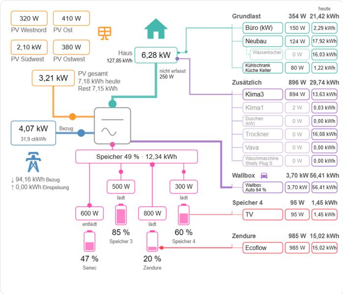

<p align="center">
  
</p>

<h1 align="center">Wattrio Energiefluss</h1>

<p align="center">
  <b>Animierter Energiefluss für Home Assistant – PV, Akkus, Netz, Haus und jeder Verbraucher in einer Karte.</b><br>
  <b>Animated energy flow for Home Assistant – PV, batteries, grid, house and every load in one card.</b>
</p>

<p align="center"><a href="#deutsch">🇩🇪 Deutsch</a> · <a href="#english">🇬🇧 English</a></p>


<details>
<summary>Klassische Karte / Classic look</summary>



</details>

*Screenshots mit simulierten Werten / Screenshots with simulated values.*

---

<a id="deutsch"></a>

# 🇩🇪 Deutsch

**Wattrio** – aus *Watt* und *Trio*: die drei Quellen PV, Akku und Netz, die in der Karte gelb, grün und blau fließen – ist eine Home-Assistant-Integration mit zwei Lovelace-Karten:

- **Wattrio Energiefluss Glas** – 2.5D-Glasoptik: Glasrohre, Züge aus leuchtenden Kugeln, deren Anzahl die Leistung zeigt, Akkus mit schwappender Flüssigkeit, ein Glasauto an der Wallbox.
- **Wattrio Energiefluss Klassik** – die klassische, flache Darstellung mit denselben Daten.

Die Integration übernimmt die Rechenarbeit (Energiebilanz, fehlende Werte, Tageszähler), die Karten zeichnen nur. Alles wird in einem visuellen Editor eingerichtet – ohne YAML.

> **Stand:** frühe Version (0.x). Karten und Editor sind auf **Deutsch**, die Sensoren der Integration haben deutsche und englische Namen.

## Grundlast und Zusatzverbraucher

Die Verbraucher werden in zwei Gruppen eingeteilt – danach, ob du bestimmen kannst, **wann** sie laufen:

- **Grundlast** – Geräte, die laufen, wann sie eben laufen müssen: Kühlschrank, Gefriertruhe, Router, Server, Heizungspumpe, Licht, Fernseher. Ihren Verbrauch kannst du kaum verschieben.
- **Zusatzverbraucher** – Geräte, bei denen du ohne Weiteres selbst entscheiden kannst, wann du sie nutzt: Waschmaschine, Trockner, Spülmaschine, E-Auto an der Wallbox, Pool-Pumpe, Warmwasser-Bereitung, Klimagerät zum Vorkühlen. Diese Geräte kannst du in Zeiten mit **PV-Überschuss** oder **günstigem dynamischem Strompreis** (z. B. Tibber) legen und so Geld sparen.

Die Karte zeigt beide Gruppen getrennt mit Leistung und Tagesverbrauch. So siehst du auf einen Blick, wie viel deines Verbrauchs fest ist und wie viel du verschieben könntest.

Daneben gibt es **Notstrom-Verbraucher**: Geräte, die direkt am eigenen Ausgang eines Akkus hängen (z. B. an einer Zendure oder EcoFlow). Sie trägst du beim jeweiligen Akku ein.

## Funktionen

**Integration**

- Einrichtung in einer eigenen Seite *Wattrio* in der Seitenleiste und im Dialog „Karte bearbeiten“.
- *Sensoren erkennen*: schlägt PV-Strings, Akkus, Netz, Preise, Wallbox und Verbraucher aus deinen vorhandenen Entitäten vor.
- PV: bis zu 4 Strings, Gesamtleistung, Ertrag heute, Prognose Rest.
- Akkus: bis zu 5, jeweils mit Leistung, Ladestand und Kapazität; Leistung als ein Sensor mit Vorzeichen oder als getrennte Sensoren für Laden und Entladen.
- Netz: ein Sensor mit Vorzeichen oder getrennt Bezug / Einspeisung; aktueller Preis (z. B. Tibber) und Einspeisevergütung.
- Verbraucher als **Grundlast** und **Zusatzverbraucher**; Verbraucher, die in anderen enthalten sind (z. B. ein Wasserkocher in einer gemessenen Unterverteilung), zählen nur einmal.
- Notstrom: bis zu 2 Akkus können eigene Notstrom-Verbraucher versorgen. Akkus, die gar nicht ins Haus einspeisen können (z. B. EcoFlow an eigenen Steckdosen), lassen sich als *entlädt nur über Notstrom* markieren: Ihr Eingang (auch was nur durchgeleitet wird) zählt auf der Hausseite, ihr Ausgang geht nur an die Notstrom-Geräte.
- Wallbox / E-Auto mit Ladestand des Autos.
- Füllt Lücken: Fehlt einer der Werte Haus, Netz, PV oder ein einzelner Akku, wird er aus den anderen berechnet.
- Eigene Sensoren: Summen je Gruppe, *nicht erfasst* (Haus minus alle gemessenen Verbraucher), Überschuss, Akku-Summen und Tagesenergie (seit Mitternacht oder rollierend 24 h) für jeden Verbraucher und für Haus, PV, Netz und Akkus – bleiben über Neustarts erhalten.

**Glas-Karte**

- Kugelzüge statt einzelner Punkte: eine **große Kugel je volle 1000 W**, eine **mittlere je volle 100 W** und eine **kleine je volle 10 W** des Rests (unter 10 W keine Kugel) – die großen fahren immer vorn, so lässt sich die Leistung am Zug ablesen.
- Die Kugelfarben zeigen die Herkunft: **gelb** PV, **grün** Akku, **blau** Netz – für Haus, jeden Verbraucher, die Wallbox und ladende Akkus.
- Wo Leitungen zusammenlaufen (PV gesamt, Haus, Speicher), münden die Züge in einen wabernden Quecksilbertropfen und verlassen ihn neu gezählt.
- Akkus und Auto füllen sich mit schwappender Flüssigkeit bis zum Ladestand; beim Laden fallen Tropfen hinein, beim Entladen steigen Blasen in die Leitung.
- Die Haus-Box zeigt das Hausnetz ohne Notstrom; eine kleine „Gesamt“-Box über den Verbrauchern zeigt den vollen Verbrauch.
- Lange Listen zeigen zuerst die größten Tagesverbraucher (8 Grundlast, 3 Zusatz); der Rest steckt in einer Sammelzeile „+ N weitere“ mit Summe, die sich aufklappen lässt.
- Leitungen weichen Akkus automatisch aus; die PV-Strings sitzen auf einem Glas-Solarmodul.
- Ein Klick auf einen Wert öffnet den zugehörigen Sensor.

## Installation

**HACS (benutzerdefiniertes Repository)**

1. HACS → ⋮ → *Benutzerdefinierte Repositories* → `https://github.com/spikesch/energiefluss` hinzufügen, Typ **Integration**.
2. **Wattrio Energiefluss** installieren und Home Assistant neu starten.
3. *Einstellungen → Geräte & Dienste → Integration hinzufügen → Wattrio Energiefluss*.

**Manuell:** den Ordner `custom_components/energiefluss` nach `config/custom_components/` kopieren und neu starten.

Die technische Kennung der Integration und der Karten lautet weiterhin `energiefluss` (Ordner, Kartentypen, Sensor-IDs).

Die Karten registriert die Integration selbst – eine eigene Lovelace-Ressource ist nicht nötig.

## Einrichtung

Der Einrichtungsdialog führt durch alles:

1. **Name** der Anlage vergeben.
2. **Gefundene Sensoren:** Wattrio sucht selbst nach PV, Netz, Batterien, Hausverbrauch, Wallbox und Strompreis und zeigt alles als Häkchenliste mit den aktuellen Werten. Nimm den Haken weg, wo etwas nicht zu deiner Anlage gehört.
3. **Look wählen:** *Glas* oder *Klassik*.

## Nach der Installation

Eine Benachrichtigung (Glocke unten links) sagt dir, wo alles ist:

- **Wattrio** steht ganz oben in der Seitenleiste und zeigt den Energiefluss. Oben schaltest du zwischen **Glas** und **Klassik** um.
- **Einstellungen** (oben rechts auf der Wattrio-Seite): Sensoren prüfen oder ändern (**Sensoren erkennen** schlägt sie erneut vor) und deine Verbraucher in **Grundlast** und **Zusatzverbraucher** einsortieren.
- **Karte auf einem eigenen Dashboard:** Dashboard bearbeiten → *Karte hinzufügen* → nach **Wattrio** suchen → *Wattrio Energiefluss Glas* oder *Klassik*. Erscheint sie nicht in der Liste, die Seite einmal neu laden.
- Die Integration legt nur Sensoren für das an, was eingerichtet ist. Kommt später etwas hinzu (z. B. ein Akku), entstehen dessen Sensoren beim Speichern.

## Was die Integration selbst berechnet

Dafür musst du **nichts** anlegen:

- **Hausverbrauch:** Gibt es keinen Sensor (oder liefert er gerade keinen Wert), wird er aus PV + Netz − Akkus berechnet.
- **Ein fehlender Wert:** Fehlt genau einer von Netz, PV oder einem Akku, rechnet die Integration ihn aus der Bilanz aus.
- **Alle Tageswerte** (seit Mitternacht oder 24 h) für jeden Verbraucher sowie für Haus, PV, Netz, Akkus und *nicht erfasst* – sie zählt selbst mit, ein eigener kWh-Zähler ist nicht nötig.
- **Summen** je Gruppe, *nicht erfasst*, Überschuss, Akku-Gesamtleistung und -Ladestand.
- **W oder kW**, getrennte oder kombinierte Sensoren für Akkus und Netz sowie ein umgedrehtes Vorzeichen stellst du direkt im Editor ein.

## Fehlende Sensoren selbst anlegen

Manches musst du dir selbst als **Helfer** anlegen: *Einstellungen → Geräte & Dienste → Helfer → Helfer erstellen*.

**Mehrere Sensoren zusammenzählen** (z. B. drei Phasen, zwei Wechselrichter, mehrere Steckdosen eines Geräts):
Helfer **Gruppe → Sensorgruppe** mit Typ **Summe** (alternativ der Min/Max-Helfer mit Typ Summe) → die Sensoren auswählen. Für PV-Strings ist das nicht nötig, die Integration addiert sie selbst.

**Gerät ohne Leistungsmessung, aber mit Schalter** (z. B. ein Heizstab mit fester Leistung):
Helfer **Template → Template-Sensor**, Einheit `W`, Geräteklasse *Leistung*, Zustandsklasse *Messung*:

```jinja
{{ 2000 if is_state('switch.heizstab', 'on') else 0 }}
```

**Eigene Berechnung** (z. B. ein eigener Hausverbrauch aus Zähler, PV und Akkus):
Ebenfalls ein **Template-Sensor**. Damit er bei einem ausgefallenen Quellsensor nicht „unbekannt“ wird, mit `| float(0)` absichern:

```jinja
{{ states('sensor.netz_leistung') | float(0)
 + states('sensor.pv_leistung') | float(0)
 + states('sensor.akku_entladen') | float(0)
 - states('sensor.akku_laden') | float(0) }}
```

**Nur ein kWh-Zähler, keine Leistung:** Daraus lässt sich keine Momentanleistung gewinnen. Für die Karte braucht jeder Verbraucher einen **Leistungssensor in W oder kW**; den Tageswert bildet die Integration dann selbst.

**Tageswerte für andere Dashboards** (Energie-Dashboard, Statistik): Die Integration legt eigene „heute“-Sensoren an. Brauchst du andere Zeiträume, nimm die Helfer **„Integral (Riemann-Summe)“** (Leistung → kWh) und **„Verbrauchszähler“** (täglich, monatlich …).

## Karten

Karte über die Kartenauswahl hinzufügen (*Wattrio Energiefluss Glas* oder *… Klassik*) oder per YAML:

```yaml
type: custom:energiefluss-glass-card   # oder custom:energiefluss-card
entry_id: 0123456789abcdef           # optional, nur bei mehreren Instanzen nötig
title: Energie                       # optional
max_power: 5000                      # optional, W – Vollausschlag der klassischen Karte
flow_style: size                     # optional, klassische Karte: "speed" oder "size" (Züge)
```

Beide Karten haben im Dialog „Karte bearbeiten“ einen visuellen Editor, der auch die Sensoren der Integration bearbeitet.

**Tipp:** Die Glas-Karte ist breit (etwa 3 : 2). In einem *Abschnitte*-Dashboard den Abschnitt über 2–4 Spalten ziehen.

## Haftungsausschluss

- Privates Hobbyprojekt, **ohne Verbindung** zu Home Assistant / Nabu Casa, HACS, Herstellern von Wechselrichtern, Akkus, Wallboxen oder Stromanbietern (z. B. Sunsynk, Tibber, Senec, Zendure, EcoFlow) oder anderen Firmen. Alle Produktnamen und Marken gehören ihren Inhabern.
- Die angezeigten Werte und die erzeugten Sensoren werden **aus deinen eigenen Sensoren berechnet** und können unvollständig, verzögert oder falsch sein. **Nicht für Abrechnung, sicherheitsrelevante Entscheidungen oder zum Steuern von Geräten verwenden**, ohne sie selbst zu prüfen.
- Die Software wird **ohne jede Gewähr** bereitgestellt, siehe [LICENSE](LICENSE). Nutzung auf eigene Gefahr.
- Die Bilder von Glasauto, Glas-Wechselrichter, Solarmodul und Logo wurden mit einem KI-Bildgenerator (Google Gemini) erstellt und für dieses Projekt bearbeitet.

## Lizenz

Copyright (C) 2026 spikesch. Lizenziert unter der **GNU General Public License, Version 3 oder später** – siehe [LICENSE](LICENSE).

Kurz: Nutzen, ändern und weitergeben ist erlaubt; wer es weitergibt – verändert oder nicht – muss es ebenfalls unter der GPL und mit Quellcode weitergeben. Mitgelieferter Fremdcode und Icons behalten ihre eigenen (GPL-kompatiblen) Lizenzen: siehe [THIRD_PARTY_NOTICES.md](THIRD_PARTY_NOTICES.md).

---

<a id="english"></a>

# 🇬🇧 English

**Wattrio** – from *Watt* and *trio*: the three sources PV, battery and grid that flow yellow, green and blue through the card – is a Home Assistant custom integration with two Lovelace cards:

- **Wattrio Energiefluss Glas** – a 2.5D glass look: glass tubes, trains of glowing balls whose number shows the power, batteries filled with sloshing liquid, a glass car at the wallbox.
- **Wattrio Energiefluss Klassik** – the classic, flat look with the same data.

The integration does the bookkeeping (energy balance, missing values, daily energy counters); the cards only draw. Everything is set up in a visual editor – no YAML needed.

> **Status:** early version (0.x). The cards and the editor are in **German**; the integration's sensors have German and English names.

## Base load and additional loads

Loads are split into two groups – by whether you can choose **when** they run:

- **Grundlast** (base load) – devices that run whenever they have to: fridge, freezer, router, server, heating pump, lights, TV. Their consumption can hardly be shifted.
- **Zusatzverbraucher** (additional loads) – devices where you can easily decide yourself when to use them: washing machine, dryer, dishwasher, the EV at the wallbox, pool pump, hot water, air conditioning for pre-cooling. You can run them when there is **PV surplus** or a **cheap dynamic electricity price** (e.g. Tibber) and save money.

The card shows both groups separately with power and daily energy, so you see at a glance how much of your consumption is fixed and how much you could shift.

In addition there are **backup loads**: devices on a battery's own output (e.g. a Zendure or EcoFlow). You add them to that battery.

## Features

**Integration**

- Setup in its own sidebar page *Wattrio* and in the card's "edit card" dialog.
- *Detect sensors*: suggests PV strings, batteries, grid, prices, wallbox and loads from your existing entities.
- PV: up to 4 strings, total, today's yield, forecast rest.
- Batteries: up to 5, each with power, state of charge and capacity; power as one signed sensor or as separate charge / discharge sensors.
- Grid: one signed sensor or separate import / export sensors; current price (e.g. Tibber) and feed-in tariff.
- Loads as **base load** and **additional loads**; loads contained in other loads (e.g. a kettle measured inside a sub-distribution) are counted only once.
- Backup: up to 2 batteries can feed their own backup loads. Batteries that cannot feed the house at all (e.g. EcoFlow on its own sockets) can be marked *only via backup*: their input (incl. pass-through) counts on the house side, their output only goes to their backup loads.
- Wallbox / EV with the car's state of charge.
- Fills gaps: if one of house, grid, PV or a single battery is not measured, it is calculated from the others.
- Own sensors: totals per group, *not measured* (house minus all measured loads), surplus, battery totals, and daily energy (since midnight or rolling 24 h) for every load and for house, PV, grid and batteries – kept across restarts.

**Glass card**

- Trains of balls instead of single dots: one **big ball per full 1000 W**, one **medium ball per full 100 W** and one **small ball per full 10 W** of the rest (below 10 W no ball) – bigger ones always lead, so you can read the power off the train.
- Ball colours show where the power comes from: **yellow** PV, **green** battery, **blue** grid – for the house, every load, the wallbox and charging batteries.
- Where lines meet (PV total, house, storage) the trains run into a wobbling mercury drop and leave it counted anew.
- Batteries and the car fill with sloshing liquid up to their state of charge; drops fall in while charging, bubbles rise into the line while discharging.
- The house box shows the house net without backup loads; a small "Gesamt" (total) box above the loads shows the full consumption.
- Long load lists show the biggest daily consumers first (8 base loads, 3 additional loads); the rest is summed up in a "+ N weitere" row that unfolds on click.
- Lines route around batteries automatically; the PV strings sit on a glass solar panel.
- Click any value to open its sensor.

## Installation

**HACS (custom repository)**

1. HACS → ⋮ → *Custom repositories* → add `https://github.com/spikesch/energiefluss`, type **Integration**.
2. Install **Wattrio Energiefluss**, then restart Home Assistant.
3. *Settings → Devices & services → Add integration → Wattrio Energiefluss*.

**Manual:** copy `custom_components/energiefluss` into `config/custom_components/` and restart.

The technical id of the integration and the cards stays `energiefluss` (folder, card types, sensor ids).

The cards are registered by the integration itself – there is no separate Lovelace resource to add.

## Setup

The setup dialog walks you through everything:

1. Give the system a **name**.
2. **Detected sensors:** Wattrio looks for PV, grid, batteries, house consumption, wallbox and electricity price by itself and shows everything as a checklist with the current values. Untick what does not belong to your system.
3. **Pick a look:** *Glas* or *Klassik*.

## After installation

A notification (bell, bottom left) tells you where everything is:

- **Wattrio** sits at the top of the sidebar and shows the energy flow. Switch between **Glas** and **Klassik** at the top.
- **Einstellungen** (settings, top right on the Wattrio page): check or change the sensors (**Sensoren erkennen** suggests them again) and sort your loads into **Grundlast** (base load) and **Zusatzverbraucher** (additional loads).
- **Card on your own dashboard:** edit the dashboard → *Add card* → search for **Wattrio** → *Wattrio Energiefluss Glas* or *Klassik*. If it is not in the list, reload the page once.
- The integration only creates sensors for what is set up. Add something later (e.g. a battery) and its sensors appear when you save.

## What the integration calculates itself

You do **not** need to create these:

- **House consumption:** without a sensor (or while it has no value) it is calculated as PV + grid − batteries.
- **One missing value:** if exactly one of grid, PV or a battery is missing, it is calculated from the balance.
- **All daily values** (since midnight or 24 h) for every load and for house, PV, grid, batteries and *not measured* – the integration counts them itself, no kWh meter needed.
- **Totals** per group, *not measured*, surplus, total battery power and state of charge.
- **W or kW**, separate or combined sensors for batteries and grid, and an inverted sign are set right in the editor.

## Creating missing sensors yourself

Some things you create yourself as a **helper**: *Settings → Devices & services → Helpers → Create helper*.

**Adding several sensors up** (e.g. three phases, two inverters, several sockets of one device):
helper **Group → Sensor group** with type **Sum** (or the min/max helper with type sum) → pick the sensors. Not needed for PV strings, the integration adds those itself.

**A device without power metering but with a switch** (e.g. a heating rod with fixed power):
helper **Template → Template sensor**, unit `W`, device class *Power*, state class *Measurement*:

```jinja
{{ 2000 if is_state('switch.heating_rod', 'on') else 0 }}
```

**Your own calculation** (e.g. your own house consumption from meter, PV and batteries):
also a **template sensor**. Use `| float(0)` so it does not become "unknown" when one source is unavailable:

```jinja
{{ states('sensor.grid_power') | float(0)
 + states('sensor.pv_power') | float(0)
 + states('sensor.battery_discharge') | float(0)
 - states('sensor.battery_charge') | float(0) }}
```

**Only a kWh meter, no power:** no current power can be derived from it. For the card every load needs a **power sensor in W or kW**; the integration then builds the daily value itself.

**Daily values for other dashboards** (energy dashboard, statistics): the integration creates its own "today" sensors. For other periods use the helpers **"Integral (Riemann sum)"** (power → kWh) and **"Utility meter"** (daily, monthly …).

## Cards

Add a card from the card picker (*Wattrio Energiefluss Glas* or *… Klassik*) or in YAML:

```yaml
type: custom:energiefluss-glass-card   # or custom:energiefluss-card
entry_id: 0123456789abcdef           # optional, only needed with several instances
title: Energie                       # optional
max_power: 5000                      # optional, W – full scale for the classic look
flow_style: size                     # optional, classic look: "speed" or "size" (trains)
```

Both cards have a visual editor in the "edit card" dialog that also edits the integration's sensor setup.

**Tip:** the glass card is wide (about 3 : 2). In a *sections* dashboard let its section span 2–4 columns.

## Disclaimer

- Private hobby project, **not affiliated with, endorsed by or connected to** Home Assistant / Nabu Casa, HACS, any inverter, battery, wallbox or energy provider (e.g. Sunsynk, Tibber, Senec, Zendure, EcoFlow) or any other company. All product names and trademarks belong to their owners.
- The values shown and the sensors created are **calculated from your own sensors** and can be incomplete, delayed or wrong. **Do not use them for billing, safety-relevant decisions or to control equipment** without checking them yourself.
- The software is provided **"as is", without warranty of any kind**, see [LICENSE](LICENSE). Use at your own risk.
- The pictures of the glass car, the glass inverter, the solar panel and the logo were created with an AI image generator (Google Gemini) and processed for this project.

## License

Copyright (C) 2026 spikesch. Licensed under the **GNU General Public License, version 3 or later** – see [LICENSE](LICENSE).

In short: you may use, change and share it; if you pass it on – changed or not – you must pass it on under the GPL with its source code. Bundled third-party code and icons keep their own (GPL-compatible) licenses: see [THIRD_PARTY_NOTICES.md](THIRD_PARTY_NOTICES.md).

---

## Entwicklung / Development

```bash
# Karten und Editor / cards and editor – built into custom_components/energiefluss/frontend
cd frontend
npm ci
npm run build
npm test

# Rechenlogik der Integration / integration logic
python -m pytest
```

- `dev/docker-compose.yml`, `dev/gen_sim.py`: separates Test-Home-Assistant mit simulierten Sensoren / separate test Home Assistant with simulated sensors.
- `scripts/deploy.ps1`: baut und lädt per SSH in diese Testinstanz (Einstellungen in `scripts/deploy.local.psd1`, siehe Beispieldatei) / builds and uploads to that test instance over SSH.
- `dev/glass_assets.py`: macht aus den Glasbildern in `dev/assets` die Karten-Bilder und das Logo / turns the glass pictures in `dev/assets` into the card assets and the logo.
